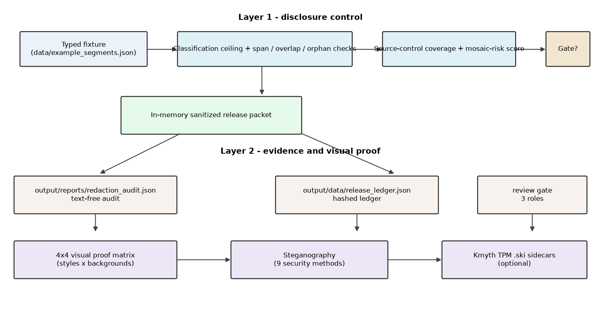

# template_redacted_report

`template_redacted_report` is a public exemplar for redacted release reports, disclosure control, and source-protection review. It is designed for lawful, accountable release workflows in intelligence, security, legal, or public-records contexts without publishing sensitive operational content.

Start with the [documentation](docs/README.md) for setup, configuration, and verification. The [manuscript](docs/manuscript/README.md) contains the release-audit methods and fixture results.

## When to use this template

Use this template when a report needs **formal redaction before release**: classification ceilings, source-control markings, redaction decisions, authority review, reviewer approvals, source-safe hash ledgers, residual-risk checks, mosaic-risk checks, and a public audit packet must be validated before any sanitized narrative is published.

## Publication and rendering

<!-- PUBLISHING-STATUS:START (generated by infrastructure.publishing.status_report) -->
**Redacted Report Template: Disclosure Control and Release Audit** · v0.1.0 · Daniel Ari Friedman

Concept DOI: [10.5281/zenodo.21298890](https://doi.org/10.5281/zenodo.21298890) | Version DOI: [10.5281/zenodo.21298891](https://zenodo.org/records/21298891) | Repository: [docxology/template_redacted_report](https://github.com/docxology/template_redacted_report)

Publishing surface — 20 platforms, 2 published:

| Platform | Tier | Status | Reference | Credentials |
| --- | --- | --- | --- | --- |
| zenodo | first-class | ✅ published | [10.5281/zenodo.21298890](https://doi.org/10.5281/zenodo.21298890) | `ZENODO_API_TOKEN` |
| github | first-class | ✅ published | [docxology/template_redacted_report](https://github.com/docxology/template_redacted_report) | `GITHUB_TOKEN` |
| arxiv | first-class | ⚪ available | — | — |
| pypi | first-class | ⚪ available | — | `PYPI_TOKEN`, `TESTPYPI_TOKEN` |
| ipfs_pinata | first-class | ⚪ available | — | `PINATA_JWT` |
| ipfs_web3storage | first-class | ⚪ available | — | `WEB3_STORAGE_TOKEN` |
| software_heritage | first-class | ⚪ available | — | — |
| github_pages | first-class | ⚪ available | [docxology/template_redacted_report](https://github.com/docxology/template_redacted_report) | `GITHUB_TOKEN` |
| cloudflare_pages | first-class | ⚪ available | — | `CLOUDFLARE_API_TOKEN` |
| netlify | first-class | ⚪ available | — | `NETLIFY_AUTH_TOKEN` |
| huggingface_hub | first-class | ⚪ available | — | `HUGGINGFACE_TOKEN`, `HF_TOKEN` |
| osf | first-class | ⚪ available | — | `OSF_TOKEN` |
| amazon_kdp | documented | 🟡 planned | — | `AMAZON_KDP_EMAIL`, `AMAZON_KDP_PASSWORD` |
| google_play_books | documented | 🟡 planned | — | `GOOGLE_PLAY_BOOKS_SERVICE_ACCOUNT_JSON` |
| gumroad | documented | 🟡 planned | — | `GUMROAD_ACCESS_TOKEN` |
| leanpub | documented | 🟡 planned | — | `LEANPUB_API_KEY` |
| lulu | documented | 🟡 planned | — | `LULU_CLIENT_KEY`, `LULU_CLIENT_SECRET` |
| draft2digital | documented | 🟡 planned | — | `DRAFT2DIGITAL_API_TOKEN` |
| stripe | documented | 🟡 planned | — | `STRIPE_SECRET_KEY`, `STRIPE_PUBLISHABLE_KEY` |
| ingramspark | documented | 🟡 planned | — | `INGRAMSPARK_CLIENT_ID`, `INGRAMSPARK_CLIENT_SECRET` |

_Keywords: redaction, disclosure control, release audit, source protection._

_Status legend: ✅ published (durable identifier recorded in `config.yaml`) · 🔵 reserved (identifier reserved but not yet registered by final publication) · ⚪ available (adapter implemented and locally verifiable) · 🟡 planned. This block is generated — edit `manuscript/config.yaml`, then regenerate with `uv run python -m infrastructure.publishing.status_report --project <path> --write`._
<!-- PUBLISHING-STATUS:END -->

See the [render and validation guide](docs/rendering.md) for the pinned renderer and output locations. Follow the [standalone fork guide](docs/standalone.md#refresh-the-publishing-status-block) to refresh this block using the config under `docs/manuscript/`.
